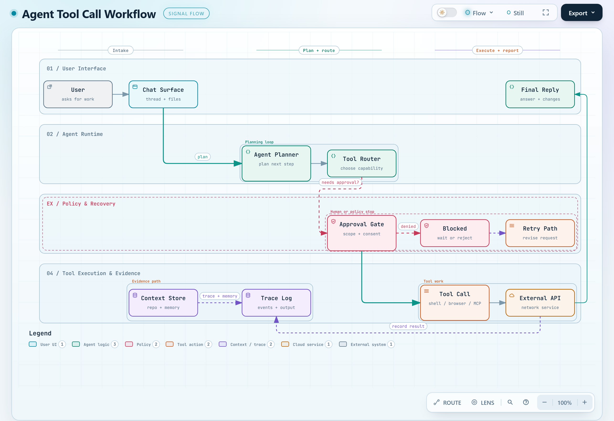

# Archify.Net

<picture>
  <source media="(prefers-color-scheme: dark)" srcset="docs/images/hero-dark.png">
  
</picture>

<sub>Archify.Net drawing itself: [`docs/images/archify-net.architecture.json`](docs/images/archify-net.architecture.json), rendered by `archify finalize architecture` through the `archify-mcp` server.</sub>

A C# port of [archify](https://github.com/tt-a1i/archify) 3.2.0, pinned at upstream tag `v3.2.0` (commit `208acba8`).
It renders architecture diagrams from JSON into standalone HTML with inline SVG, and checks the result.
The correctness bar is byte parity: the HTML it writes is byte-identical to upstream's for the same input.
The reader-side viewer stays JavaScript and is embedded verbatim from `upstream/`.

.NET 10, C# 14, no NuGet dependencies in the library.

## Contents

- [Status](#status)
- [Quick start](#quick-start)
- [Library surface](#library-surface)
- [Diagram types](#diagram-types)
- [Source evidence](#source-evidence)
- [Command-line tool](#command-line-tool)
- [MCP server and skill](#mcp-server-and-skill)
- [Build and test](#build-and-test)
- [How parity is tested](#how-parity-is-tested)
- [Repository layout](#repository-layout)
- [Updating fixtures from upstream](#updating-fixtures-from-upstream)
- [Design documents](#design-documents)
- [Known deviations from upstream](#known-deviations-from-upstream)
- [Credits and license](#credits-and-license)

## Status

The port is built library first (`Archify.Net.Core`), then a CLI, then an MCP server.

| Phase | Scope | Status |
|---|---|---|
| 1 | Foundation, validation gates, architecture renderer, artifact checker | Done |
| 2 | erd/grid, sequence, lifecycle, class, tree, timeline, waterfall renderers | Done |
| 3 | workflow and dataflow renderers | Done |
| 4 | erd renderer and repository evidence | Done |
| 5 | CLI, receipts, sidecars, lock and journal, Playwright browser and visual gates | Done |
| 6 | MCP server and SKILL.md | Done |
| PORT-007 | Re-pin to upstream 3.2.0: timeline DST ticks, waterfall time precision, erd bridges, migration contracts, CLI `browserCheck` | Done |
| PORT-008 | Pele charts in C#: pie, xychart, quadrantChart, sankey, radar, venn | Done |
| PORT-009 | The explainer type: one-page answers from a Markdown draft, `patch`, the explainer browser gate, `archify_patch` and the re-derived skill | Done |

The full suite (`dotnet test`) runs 7388 tests: 6334 in `Archify.Net.Core.Tests`, 1037 in `Archify.Net.Cli.Tests` and 17 in `Archify.Net.Mcp.Tests` (0 failed, 0 warnings; 76 of them are in the `Browser` category and need Chromium).
Per-phase parity results and test counts are in [`docs/status.md`](docs/status.md).

## Quick start

Reference `src/Archify.Net.Core/Archify.Net.Core.csproj` (there is no NuGet package yet), then:

```csharp
using System.Text.Json.Nodes;
using Archify.Net;

var diagram = JsonNode.Parse(File.ReadAllText("web-app.architecture.json"))!;

var result = ArchifyNet.Render(DiagramType.Architecture, diagram);
if (result.Html.Length == 0)
{
    // Input or renderer problems never throw: they come back as diagnostics with upstream's codes.
    foreach (var d in result.Diagnostics)
        Console.Error.WriteLine($"{d.Severity} {d.Code} {d.Path}: {d.Message}");
    return 1;
}

File.WriteAllText("web-app.html", result.Html);

// The artifact checker upstream runs on a written file, here on the HTML string.
var check = ArchifyNet.Check(result.Html);
Console.WriteLine(check.Ok ? "check ok" : check.Report.ToJsonString());
return 0;
```

`DiagramTypes.Parse("sequence")` maps upstream's type names to the enum. Example inputs for every type are under
`upstream/examples/` (`<name>.<type>.json`).

## Library surface

`Archify.Net.Core` exposes one static facade, `ArchifyNet`, in namespace `Archify.Net`:

- `Render(type, diagram, options)` runs the load gates and the renderer. It returns a `RenderResult`: `Html`, `Svg`,
  `Cards`, `Diagnostics` and `Layout` (the layout report upstream prints with `--layout-json`).
- `Check(html, options)` runs the artifact checker. Its `Report` JSON equals upstream's
  `scripts/check-render-output.mjs` minus `file`; `Ok` mirrors the report's `ok`.
- `Validate(type, diagram, options)` renders, checks, and returns the render diagnostics followed by the checker's.

`RenderOptions(Quality, RepoRoot)` selects the quality profile (`Standard` or `Showcase`, upstream's environment-driven
profile as an option) and the repository root for evidence (see [Source evidence](#source-evidence)).
`CheckOptions(RequireProvenance)` is not implemented in the library: the provenance checks live in the CLI (`archify check --require-provenance`).

Input and validation problems come back as `Diagnostic` records with upstream's codes, messages, subjects, evidence
and supported fixes. Any other renderer error comes back as an `internal/unclassified` diagnostic whose evidence names
the exception type, as upstream's JSON-mode boundary does. All ten diagram types render. The facade throws only
`NotSupportedException`, from `Check` when `RequireProvenance` is set (use the CLI for provenance checks).

The facade is named `ArchifyNet`, not `Archify`: a class of that name inside namespace `Archify.Net` cannot be named
from consumer code.

## Diagram types

| Type | Upstream renderer | Port | Phase | Example |
|---|---|---|---|---|
| architecture | `renderers/architecture` | `src/Archify.Net.Core/Architecture` | 1 | [`web-app`](https://mbrekhof.github.io/Archify.Net/upstream/examples/web-app-rendered.html) ([JSON](upstream/examples/web-app.architecture.json)) |
| sequence | `renderers/sequence` | `src/Archify.Net.Core/Sequence` | 2 | [`cache-miss-request`](https://mbrekhof.github.io/Archify.Net/upstream/examples/sequence-cache-miss-request.html) ([JSON](upstream/examples/cache-miss-request.sequence.json)) |
| lifecycle | `renderers/lifecycle` | `src/Archify.Net.Core/Lifecycle` | 2 | [`agent-run`](https://mbrekhof.github.io/Archify.Net/upstream/examples/lifecycle-agent-run.html) ([JSON](upstream/examples/agent-run.lifecycle.json)) |
| class | `renderers/class` | `src/Archify.Net.Core/Class` | 2 | [`payment-processors`](https://mbrekhof.github.io/Archify.Net/upstream/examples/class-payment-processors-rendered.html) ([JSON](upstream/examples/payment-processors.class.json)) |
| tree | `renderers/tree` | `src/Archify.Net.Core/Tree` | 2 | [`payment-platform`](https://mbrekhof.github.io/Archify.Net/upstream/examples/tree-payment-platform-rendered.html) ([JSON](upstream/examples/payment-platform.tree.json)) |
| timeline | `renderers/timeline` | `src/Archify.Net.Core/Timeline` | 2 | [`payment-incident`](https://mbrekhof.github.io/Archify.Net/upstream/examples/timeline-payment-incident-rendered.html) ([JSON](upstream/examples/payment-incident.timeline.json)) |
| waterfall | `renderers/waterfall` | `src/Archify.Net.Core/Waterfall` | 2 | [`checkout-request`](https://mbrekhof.github.io/Archify.Net/upstream/examples/waterfall-checkout-request-rendered.html) ([JSON](upstream/examples/checkout-request.waterfall.json)) |
| workflow | `renderers/workflow` | `src/Archify.Net.Core/Workflow` | 3 | [`agent-tool-call`](https://mbrekhof.github.io/Archify.Net/upstream/examples/workflow-agent-tool-call-rendered.html) ([JSON](upstream/examples/agent-tool-call.workflow.json)) |
| dataflow | `renderers/dataflow` | `src/Archify.Net.Core/Dataflow` | 3 | [`product-analytics`](https://mbrekhof.github.io/Archify.Net/upstream/examples/dataflow-product-analytics.html) ([JSON](upstream/examples/product-analytics.dataflow.json)) |
| erd | `renderers/erd` | `src/Archify.Net.Core/Erd` | 4 | [`orders`](https://mbrekhof.github.io/Archify.Net/upstream/examples/erd-orders-rendered.html) ([JSON](upstream/examples/orders.erd.json)) |

All ten types are ported.

### Charts

archify 3.2.0 draws charts for its explainer type with a vendored copy of Pele 1.3.0. `src/Archify.Net.Core/Pele` ports
it. The six chart fence types (pie, xychart, quadrantChart, sankey, radar, venn) render to SVG as archify 3.2.0 does,
byte for byte, apart from the deviations in [`docs/deviations.md`](docs/deviations.md#pele-charts-port-008). They are
reached through the explainer type (below): a `mermaid` fence or a chart data file in an explainer draft.

### Explainer

archify 3.2.0's `explainer` type turns a Markdown (or JSON) draft into a one-page answer: the conclusion first, then
structured panels with native diagrams and charts. `ArchifyNet.RenderExplainer` renders it from the library; the CLI takes it
in `validate`, `deliver`, `render`, `check`, `patch` and `finalize` (`archify finalize explainer answer.archify.md answer.html
--browser-check` adds the browser gate), and `archify-mcp` in `archify_validate`, `archify_render`, `archify_finalize` and
`archify_patch`. A page equals upstream's byte for byte except its gzip payloads, which are .NET's stream and inflate to the
same bytes (see [`docs/deviations.md`](docs/deviations.md#explainer-port-009)).

Showcase: [`showcase/explainer/`](showcase/explainer/index.html) holds four explainers rendered by the port with
`archify deliver explainer <case>.archify.md <case>.html --quality standard`, from the drafts of upstream's cases. Live at
https://mbrekhof.github.io/Archify.Net/showcase/explainer/ next to upstream's own copies at
https://tt-a1i.github.io/archify/cases/explainer/. The committed pages equal a v3.2.0 render (`Showcase_pages_match_upstream`),
but upstream's committed `docs/cases/explainer/*.html` do not: each of their native children carries
`<meta name="generator" content="archify 3.1.1-dev.1">` where v3.2.0 writes `archify 3.2.0`, from an older build. So their children's
SHA-256, manifest, bundle digest and `data-revision` differ from a v3.2.0 render; every other child byte is equal.

## Source evidence

A diagram can cite the code it describes. Pass the root of a local clone:

```csharp
var result = ArchifyNet.Render(DiagramType.Architecture, diagram, new RenderOptions(RepoRoot: @"C:\src\my-repo"));
```

- The diagram needs `meta.repository` (`url` and a 40-hex `revision`, optionally `provider` and `link_mode`) and
  `sources` on its nodes.
- `git` must be on PATH. The port runs it as a child process, as upstream does. `Render` with `RepoRoot` runs git
  synchronously with no timeout (as upstream), so it can block if git stalls (for example a repo on a stalled network
  share), and each git call holds dedicated threads (not thread-pool threads) while it runs.
- Before rendering, the load gates verify the clone against the diagram: the origin remote identifies the same repository
  as `meta.repository.url`, the revision exists in the clone, and every cited file and line range exists at that revision.
  A failure comes back as a `repository-evidence/*` diagnostic with upstream's code and message.
- The verified payload lands in the HTML template. The SVG changes only by the source badges in dataflow, lifecycle,
  tree and workflow diagrams.
- Without `RepoRoot`, or for a diagram with no `meta.repository` and no sources, no `git` process starts.

## Command-line tool

`src/Archify.Net.Cli` is the `archify` dotnet tool (net10.0). It is a port of upstream's `bin/archify.mjs`, with the deviations
listed in [`docs/deviations.md`](docs/deviations.md#cli-phase-5).

Install (there is no NuGet feed yet; pack it first):

```
dotnet pack src/Archify.Net.Cli -o nupkg
dotnet tool install --global Archify.Net.Cli --add-source nupkg
archify install-browser
```

`archify install-browser` downloads the pinned Playwright Chromium headless shell. Only `browser-check`, `visual-check` and
`finalize` need it; `archify doctor` reports whether it is installed.

Commands, each with one example (`<type>` is one of architecture, workflow, sequence, dataflow, lifecycle, erd, tree, class,
timeline, waterfall, or `explainer` for `validate`, `deliver`, `render` and `finalize`, whose input is then a `.md` or `.json` draft;
`archify --help` prints the full usage):

| Command | Example |
|---|---|
| `render` | `archify render architecture web-app.json web-app.html` |
| `deliver` | `archify deliver architecture web-app.json web-app.html --json` |
| `finalize` | `archify finalize architecture web-app.json web-app.html --receipt receipt.json` |
| `validate` | `archify validate architecture web-app.json --layout-json` |
| `inspect` | `archify inspect architecture web-app.json` |
| `check` | `archify check web-app.html --require-provenance` |
| `browser-check` | `archify browser-check web-app.html --summary` |
| `visual-check` | `archify visual-check web-app.html --out-dir evidence` |
| `guide` | `archify guide "payment flow" --lang en` |
| `examples` | `archify examples` (renders 15 example diagrams to HTML in `./examples/`) |
| `patch` | `archify patch explainer answer.html clauses replacement.md revised.html --json` (explainer pages only) |
| `doctor` | `archify doctor` |
| `install-browser` | `archify install-browser` |
| `demo` | `archify demo demo-out` (writes `demo-out/archify-demo.html`) |

`--quality standard|showcase` overrides the diagram's `meta.quality_profile`. Without it, `finalize` uses showcase; every other
command uses the diagram's `meta.quality_profile`, else standard. `--repo-root <path>` is the other flag; the CLI reads no
`ARCHIFY_*` environment variable.
`deliver` writes the artifact plus a `<name>.delivery.json` provenance sidecar; `finalize` runs deliver, check and browser-check
and writes a receipt.

Exit codes, as upstream's: `0` success; `1` the command ran and failed (diagnostics, a failed gate, a crash); `2` the command
could not run or was refused (usage and argument errors, an unknown command, an unsupported option, Chromium unavailable).
One exception, as upstream (A:5633-5635): `browser-check` and `visual-check` exit `1` on an unknown option or a wrong number of
arguments (`--out-dir` without a value still exits `2`).
`--json` prints the receipt on stdout; without it the diagnostics go to stderr.

## MCP server and skill

`src/Archify.Net.Mcp` is the `archify-mcp` stdio MCP server (`ModelContextProtocol` 2.2.0). It dispatches its five tools in-process through `Archify.Net.Cli`.

Pack and install both dotnet tools (and the Chromium headless shell for `archify_finalize`):

```
dotnet pack src/Archify.Net.Cli -o nupkg
dotnet pack src/Archify.Net.Mcp -o nupkg
dotnet tool install --global Archify.Net.Cli --add-source nupkg
dotnet tool install --global Archify.Net.Mcp --add-source nupkg
archify install-browser
```

Register the server with Claude Code (`--` before the command is required; `--transport stdio` may be written before the name since `stdio` is the default):

```bash
claude mcp add archify -- archify-mcp
```

The default scope is `local`; pass `--scope user` to register the server for all of the user's projects.

For MCP clients that use a `mcpServers` JSON configuration:

```json
{
  "mcpServers": {
    "archify": {
      "command": "archify-mcp",
      "args": []
    }
  }
}
```

Tools exposed by `archify-mcp`:

| Tool | Parameters | Description |
|---|---|---|
| `archify_guide` | `query?`, `lang?` (`"en"` \| `"zh"`) | Recommend a diagram type and scenario recipe for a plain-language scenario or question, or list all scenario recipes when `query` is omitted. |
| `archify_validate` | `type`, `input`, `layoutJson?`, `quality?`, `repoRoot?`, `writing?`, `cwd?` | Validate a JSON specification against schema, layout and composition rules, or emit the resolved layout geometry report (`--layout-json`) when `layoutJson` is `true`. |
| `archify_render` | `type`, `input`, `output?`, `quality?`, `repoRoot?`, `cwd?` | Render a JSON specification directly to a standalone HTML file and return the resolved output HTML path written by the CLI. |
| `archify_finalize` | `type`, `input`, `output`, `receipt?`, `outDir?`, `quality?`, `repoRoot?`, `candidateSha256?`, `writing?`, `browserCheck?`, `cwd?` | Run `validate`, `deliver`, strict `check` and headless Chromium `browser-check`, returning the compact JSON finalize receipt. For an `explainer`, the browser check runs only when `browserCheck` is `true`. |
| `archify_patch` | `artifact`, `panelId`, `replacement`, `output`, `quality?`, `repoRoot?`, `writing?`, `cwd?` | Replace one panel of a delivered explainer page with a Markdown panel of the same stable id, and return the JSON patch receipt. |

CLI exit code `0` maps to `IsError = false`; exit codes `1` and `2` map to `IsError = true` with the full JSON receipt or diagnostic text in the tool result content.

To install the self-contained agent skill (`SKILL.md`, `references/`, `schemas/`, `examples/`), copy `skill/archify/` into `~/.claude/skills/archify` (or `<repo>/.claude/skills/archify`).

## Build and test

From the repo root:

```
dotnet test
```

Tests in category `Browser` need Chromium (`archify install-browser`) and take about 2.5 minutes. `dotnet test --filter
Category!=Browser` skips them. A test that needs git or Chromium fails loudly, naming the fix, when it is missing. The real-browser
references were minted with Chromium headless shell 1243 on Windows fonts. The real-filesystem tests need Windows Developer Mode
(file symlinks) and 8.3 short names enabled on `%TEMP%`.

The parity suite reads the goldens and fixtures committed under `tests/` and `upstream/`. It needs no network and no Node.
Warnings are errors (`Directory.Build.props`). The time-zone tests assume Windows with ICU (Windows 10 1903 or later);
two facts fail elsewhere by design (see the time-zone deviations in [`docs/deviations.md`](docs/deviations.md)).

## How parity is tested

Every expected value in the suite was produced by upstream, never written by hand:

- **Rendered goldens** (`tests/goldens/*-rendered.html`): upstream's own goldens plus goldens minted by running
  upstream on example inputs and on targeted fixture inputs. `ParityTests.Render_is_byte_identical_to_upstream`
  renders each input and compares bytes.
- **Checker reports** (`tests/goldens/checker/*.json`): upstream's checker run over each golden.
  `ArtifactCheckerTests` asserts the port's report equals it.
- **Failure receipts** (`tests/fixtures/diagrams/*.expected.json`): upstream's diagnostics for inputs that fail a
  renderer's own checks, one per diagnostic code. The receipt theories compare code order, message, severity,
  subject, evidence and supported fixes.
- **Layout reports**: upstream's `--layout-json` per golden input for class, tree, timeline and waterfall.
- **Workflow compiler receipts** (`tests/fixtures/workflow/*.receipt.json`): upstream's `--layout-json` for workflow inputs.
  Failure receipts also compare `suppresses`.
- **Js fixtures** (`tests/fixtures/js/*.json`): V8's answers for the JavaScript semantics the renderers lean on:
  number formatting, sorting, grapheme segmentation, text wrapping, `Date` parsing and time-zone conversion, plus the
  phase-3 helpers (word-breaks, label-capacity, joint-label-routing, workflow-model).
  The `Js` layer in `src/Archify.Net.Core/Js` reproduces them, and `JsTests`, `JsTextTests` and `JsTimeTests` pin it.
- **Schema battery**: the JSON Schemas in `upstream/schemas` are embedded and enforced by a port of the ajv subset
  upstream uses; `ValidationTests` checks the error set against ajv's.

## Repository layout

```
src/Archify.Net.Core/        the library
  Archify.cs                 ArchifyNet facade, renderer dispatch
  Shared/                    loader, validation gates, diagnostics, geometry, routing, brand marks, i18n, template writer, checker
  Js/                        V8-compatible number, string, sort, text segmentation and time helpers
  <Type>/                    one renderer per diagram type
  Erd/                       the erd renderer; Grid.cs, the banded grid, is shared with class
  Evidence/                  repository evidence verifier, remote URL parser, git runner
  Pele/                      the Pele 1.3.0 chart port (six chart types)
  Explainer/                 the explainer type: parser, validator, preparation, renderer, checker, panel patch, and the chart entry points
src/Archify.Net.Cli/         the archify dotnet tool: dispatch, commands, delivery (lock, journal, sidecars), browser gates, finalize
src/Archify.Net.Mcp/         the archify-mcp stdio MCP server (archify_guide, archify_validate, archify_render, archify_finalize, archify_patch)
skill/archify/               self-contained agent skill package (SKILL.md, references/, schemas/, examples/)
tests/Archify.Net.Core.Tests xUnit suite
tests/Archify.Net.Cli.Tests  xUnit suite for the CLI (fixtures in tests/fixtures/cli)
tests/Archify.Net.Mcp.Tests  xUnit suite for the MCP server and skill package
tests/goldens/               upstream-rendered HTML and checker reports
tests/fixtures/              diagram inputs, receipts, layout reports, Js fixtures, checker probes
showcase/explainer/         four explainer drafts and their rendered pages (GitHub Pages)
upstream/                    verbatim copy of the upstream skill package files the port embeds or tests against
                             (schemas, locales, viewer, template, brand marks, references, examples)
tools/capture-fixtures.mjs   dev-time fixture minting from upstream (Node)
tools/capture-cli-fixtures.mjs  dev-time CLI fixture minting: runs upstream's bin/archify.mjs, records args, exit, stdout, stderr
tools/chart-seeds/           chart seed inputs and fuzz settings for the capture (see its README)
tools/explainer-seeds/       explainer seed inputs for the capture (see its README)
tools/pele-internals/        a bundle of Pele 1.3.0 internals the capture calls
tools/v8-math/               V8 math fixture generator (sin, cos, acos, atan2, log10, pow)
docs/status.md               per-phase parity results
docs/deviations.md           known deviations from upstream
docs/superpowers/            design spec, phase plans, rulings and plan reviews
```

`upstream/UPSTREAM.md` records the pinned commit and how the copy was taken. The library embeds the schemas,
locales, HTML template and brand-mark catalog from `upstream/` as resources, so the built DLL is self-contained.

## Updating fixtures from upstream

`tools/capture-fixtures.mjs` is a dev-time tool that mints the goldens, receipts, layout reports and Js fixtures
from upstream. It needs Node 24 and an upstream repo checkout at `C:\projects\archify` on tag `v3.2.0` (`208acba8`). It reads
the skill package root inside it, `C:\projects\archify\archify`. It is deterministic: a re-run on the pinned commit
rewrites every file byte-identically. CI never runs it; the test suite only reads what it committed.

To add a parity case, add the input mutation to the script, run it from the repo root with `node
tools/capture-fixtures.mjs`, and add the matching row to `ParityTests`.

## Design documents

- Design spec: `docs/superpowers/specs/2026-10-13-archify-csharp-port-design.md`, with its review next to it.
- Phase 1 plan: `docs/superpowers/plans/2026-10-13-phase1-foundation-architecture.md`, plus its review and the
  phase-1 rulings (`2026-10-13-phase1-rulings.md`).
- Phase 2 plan: `docs/superpowers/plans/2026-10-14-phase2-renderers.md`, plus its review.
- Phase 3 plan: `docs/superpowers/plans/2026-10-14-phase3-workflow-dataflow.md`.
- Phase 4 plan: `docs/superpowers/plans/2026-10-15-phase4-erd-evidence.md`.
- Phase 5 plan: `docs/superpowers/plans/2026-10-15-phase5-cli.md`.
- Phase 6 plan: `docs/superpowers/plans/2026-10-15-phase6-mcp.md`.
- `SESSION_HANDOFF.md`: current state, carried items and the next step.

## Known deviations from upstream

See [`docs/deviations.md`](docs/deviations.md) for the list of library, renderer, repository-evidence, CLI and chart deviations from upstream.

## Credits and license

Archify is by tt-a1i, building on work by Cocoon AI, and is MIT-licensed. The files under `upstream/` are copied from it
unchanged, and its license is kept at `upstream/LICENSE`. Archify.Net is MIT-licensed as well; see `LICENSE`, which
carries the upstream copyright notices alongside the port's. The chart port is derived from Pele (MIT, © 2026 kepano);
its notice and the V8/fdlibm notice are in [`THIRD_PARTY_NOTICES.md`](THIRD_PARTY_NOTICES.md).
