# P99 rose from 80 ms to 600 ms while the mean barely moved: a few requests got slow {#p99-tail}

A P99 spike with a flat mean means the slowest 1–2% of requests went from 80 ms to 600 ms while the rest stayed normal. The usual causes are queueing and contention, one bad instance or a slow downstream, or a few requests taking a slow path. Start the triage from the traces of slow requests, not from global metrics.

- The mean is blind to the tail: 15 of 1000 requests at 600 ms raise the mean by only about 8 ms.
- A worse tail almost always means one subset of requests has a problem, not the whole endpoint.
- The order: first find which segment is slow, then slice by dimension, then compare with changes and resources.

@answer scope="Illustrative numbers · a typical web or microservice endpoint · P99 is the 990th of 1000 values"
@meta locale=en

## Why did the mean not move? {#why-mean-flat}

```mermaid title="Endpoint latency before and after"
xychart-beta
  x-axis ["Mean", "P50", "P99"]
  y-axis "ms" 0 --> 700
  bar "Before" [80, 80, 80]
  bar "After" [88, 80, 600]
```

Take 985 requests at 80 ms plus 15 at 600 ms. The mean is `(985×80 + 15×600) / 1000 = 87.8` ms, only 7.8 ms more. P99 takes the 990th value, which falls among the 15 slow requests, so it jumps to 600 ms. The mean hides tail problems, which is exactly why you monitor P95 and P99.

## In what order do you triage? {#triage-order}

@workflow id=p99-triage title="Triage order: locate first, then slice"
| lane locate | Locate |
| lane split | Slice |
| lane fix | Compare |
| confirm | Confirm the metric | external | locate |
| trace | Sample slow traces | backend | locate |
| dim | Slice by instance, downstream, parameter | backend | split |
| change | Compare releases and config | backend | fix |
| res | Check resource contention | backend | fix |
| confirm > trace | Real |
| trace > dim | Slow segment |
| dim > change | One dimension |
| change > res | No change |

@steps id=triage-steps
| s1 | Confirm the metric | Check whether P50 and P95 rose too, and rule out a change in aggregation or sampling. | p99-triage | confirm |
| s2 | Sample slow traces | Pull at least 10 traces of 500 ms or more; see whether the time goes to queueing, downstream calls or own processing. | p99-triage | trace |
| s3 | Slice by instance, downstream, parameter | Are the slow requests on one instance, one downstream, or do they share a parameter? | p99-triage | dim |
| s4 | Compare releases and config | Line the spike's start up with deploys, config changes, feature flags and dependency upgrades. | p99-triage | change |
| s5 | Check resource contention | Look at connection pool waits, thread pool queues, GC pauses, CPU throttling and lock contention. | p99-triage | res |

## What are the likely causes? {#causes}

| Candidate cause | Typical sign | How to confirm |
| --- | --- | --- |
| Queueing and contention | Waiting dominates the trace; latency moves with load | Check connection and thread pool wait times and queue depth {caution:Most common} |
| One bad instance | Slow requests sit on one or two nodes | Slice P99 by instance and find the outlier |
| Slow downstream tail | Downstream spans take over 80% of slow traces | Check slow queries, lock waits and cache hit rate |
| Slow path or unusual parameters | Slow requests share a parameter, a user or a large body | Cluster the features of the slow samples |
| GC or runtime pauses | Periodic spikes that line up with the GC log | Compare stop-the-world pauses with the spike times |
| Retry amplification | Occasional downstream timeouts trigger retries | Check whether downstream QPS rose in step |

## Checklist {#checklist}

- [ ] Pull the last hour's traces of 500 ms or more, at least 10
- [ ] Slice the slow requests by instance, downstream and endpoint parameter
- [ ] Line the spike's start up with the deploy, config and flag timeline
- [ ] Check pool waits, GC pauses and CPU throttling metrics
- [ ] Confirm the P50 and P95 trend, to tell a worse tail from a metric change
